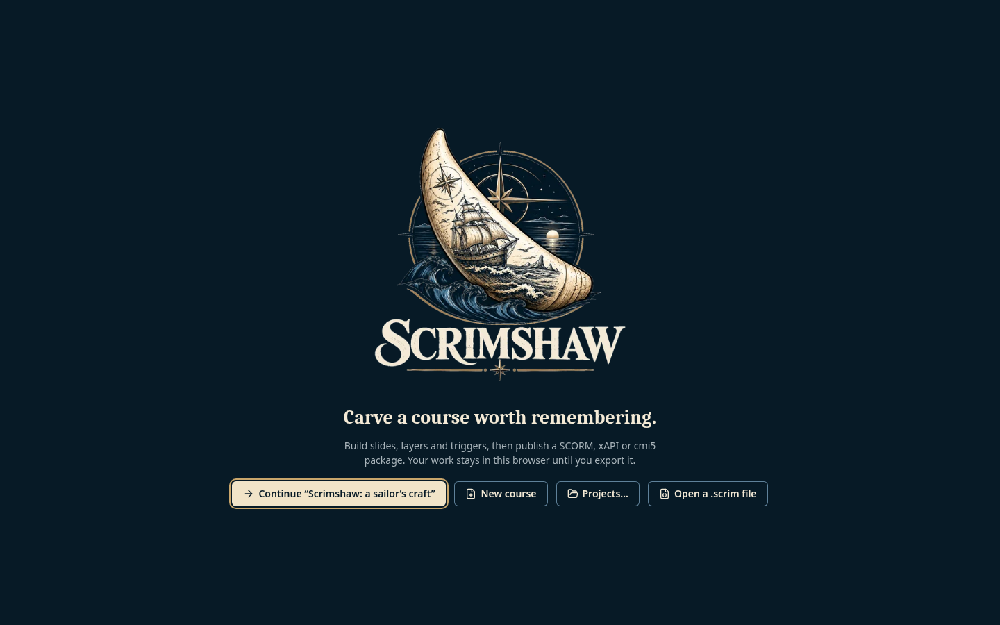
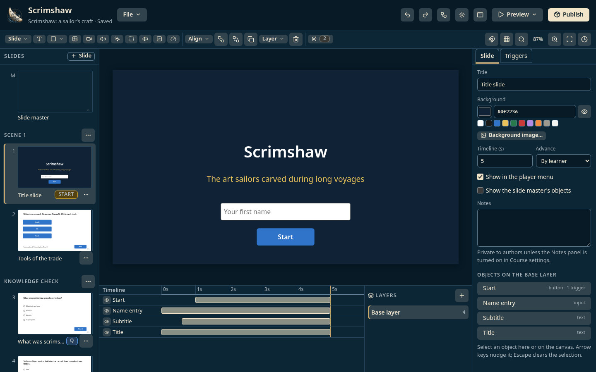
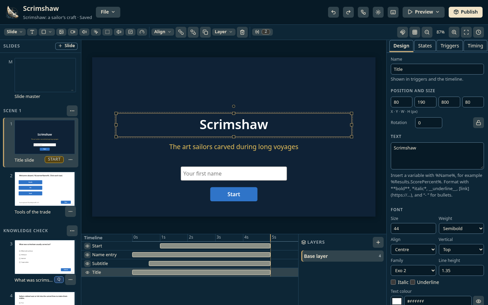
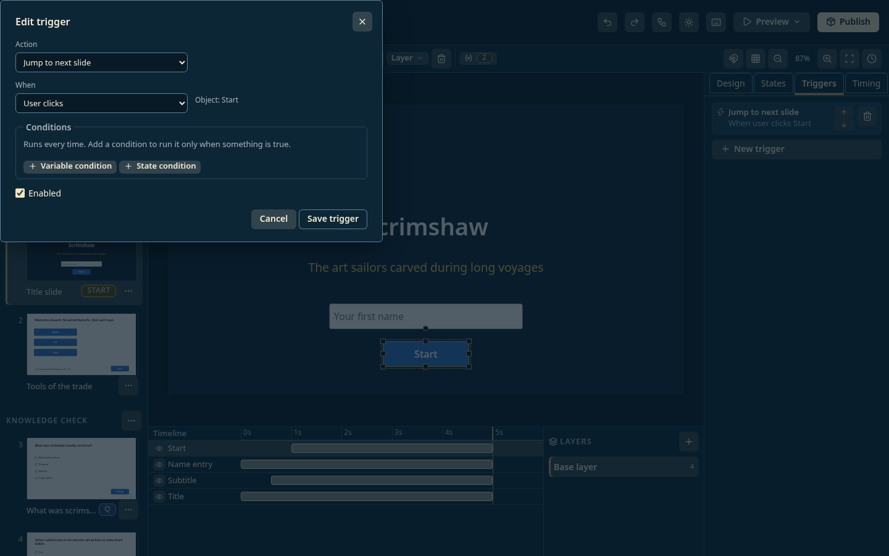
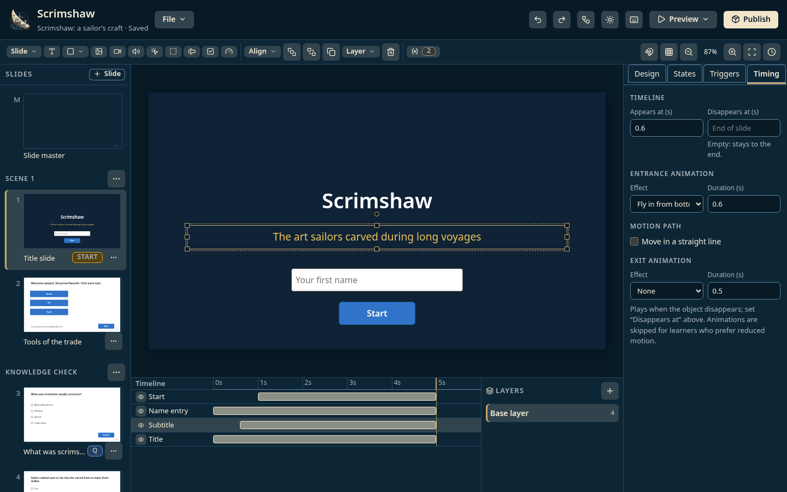
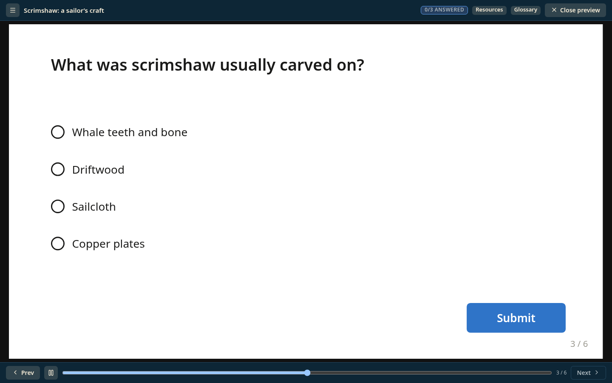
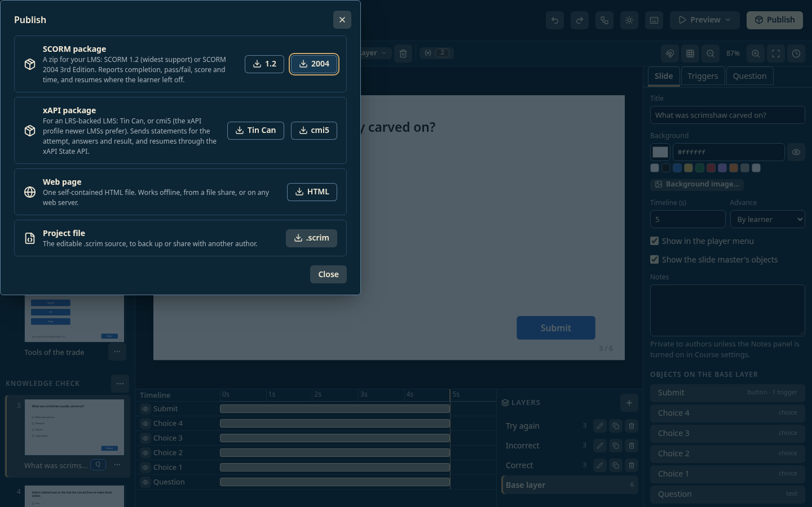

# Scrimshaw walkthrough

Build an interactive course from slides, triggers and a quiz, preview it, and publish it as SCORM or a web page.

> **Screenshots:** captured with demo data and scanned by the Chief of Staff (team directive 10). Steps marked *Screenshot pending* still need a new capture; their image links do not resolve yet.

## Before you start

- Windows PowerShell 5.1 (part of Windows). No administrator rights and no installer.
- Microsoft Edge or Google Chrome.
- Launch: Double-click `Launch.bat` (or open `dist/index.html` directly in Edge or Chrome).

## Steps

### 1. First launch

Scrimshaw opens on its welcome screen, *Carve a course worth remembering*. The sample course, *Scrimshaw: a sailor's craft*, is already in the browser, so the first button offers to continue it.

### 2. Open the sample course

Select **Continue "Scrimshaw: a sailor's craft"**. The editor shows the slide list, the slide canvas, the timeline and layers, and the Inspector.

### 3. Edit an object

Select an object on the canvas and change it in the **Inspector**.

### 4. Add a trigger

Select an object and open **Triggers**, then **New trigger**. Pick an action, an event and any conditions. The trigger is listed in plain English, for example *Jump to next slide when user clicks Start*.

### 5. Time the slide

The **Timeline** sets when each object appears and disappears.

*Screenshot pending: a new capture is needed for this step.*

### 6. Preview

Preview the course in the player, including the quiz.

### 7. Publish

**Publish** builds a SCORM 1.2 or 2004, xAPI, cmi5 or web package after checking for broken references and missing alt text.

*Screenshot pending: a new capture is needed for this step.*

## About these images

Images live in [`docs/assets/walkthrough/`](../assets/walkthrough/), named `NN-<screen>.png` after the step they belong to. They are 1440x900 at 100% scale in the Dark theme, and show demo data only.
